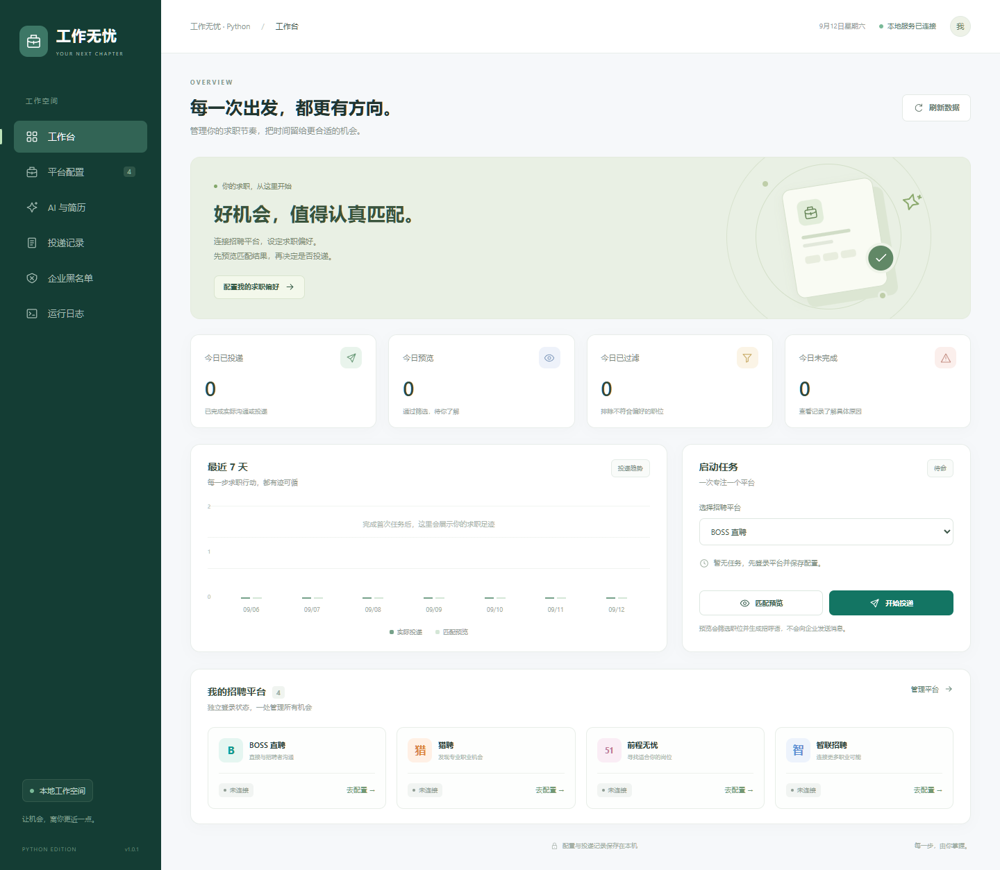
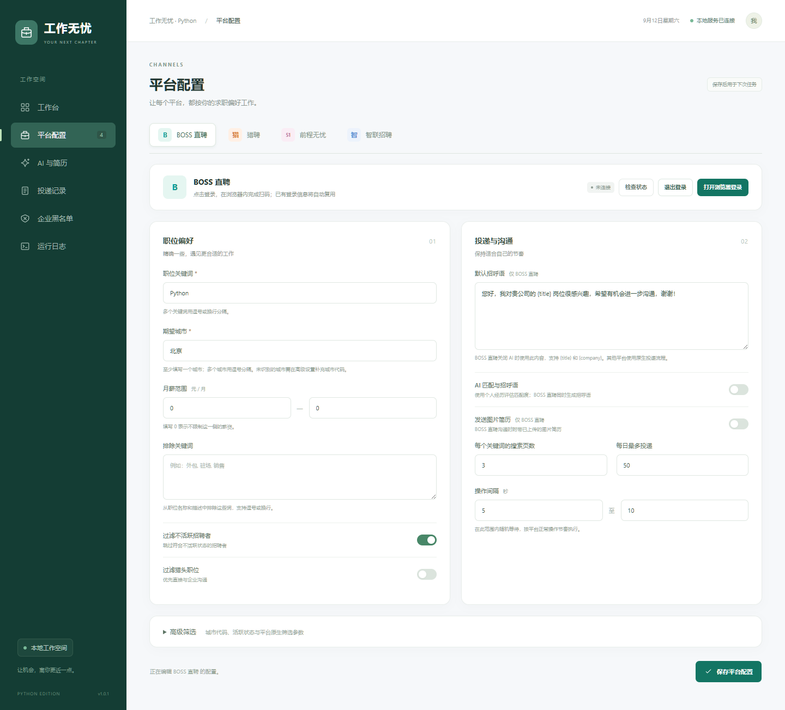

<p align="center">
  
</p>

<h1 align="center">工作无忧 · Python</h1>

<p align="center"><strong>好机会，值得认真匹配。</strong></p>

<p align="center">四平台求职管理 · AI 职位匹配 · 先预览后投递 · 本地数据存储</p>

<p align="center">
  <a href="#version-updates"></a>
  <a href="#quick-start"></a>
  <a href="#quick-start"></a>
  <a href="LICENSE"></a>
</p>

<p align="center">
  <a href="#features">功能概览</a> ·
  <a href="#preview">界面预览</a> ·
  <a href="#tech-stack">技术栈</a> ·
  <a href="#quick-start">开始使用</a> ·
  <a href="#version-updates">版本更新</a> ·
  <a href="#validation">验证记录</a>
</p>

工作无忧是一个本地运行的求职助手。你可以在中文管理界面中设置岗位、城市和薪资偏好，连接 **BOSS 直聘、猎聘、前程无忧、智联招聘**，查看匹配结果、管理投递记录，并按需使用 AI 分析职位与个人经历的匹配程度。

程序采用 **FastAPI + SQLite + 浏览器自动化**，无需 Java、Node.js 构建或外部数据库。Windows 可使用单文件 EXE，也可通过 Python 源码启动。

当前版本 **v1.0.1** 主要完善 BOSS 登录页复用、刷新与重定向异常处理，以及旧版服务识别。完整变化见[版本更新](#version-updates)。

> **验证范围：** 已有本地测试、公开登录页观察和 EXE 启动检查记录；真实账号登录后的搜索、投递、图片送达和外部 AI 服务仍需分别验收。下方截图来自当前源码的隔离空数据环境。

<a id="features"></a>

## 一个工作台，管理你的求职节奏

| 你要完成的事 | 当前提供的能力 |
| --- | --- |
| 一处管理四个平台 | 独立平台配置、登录状态、搜索地址、职位读取与分页 |
| 找到符合偏好的岗位 | 多关键词、多城市、月薪范围、排除词、HR 活跃状态与猎头筛选 |
| 让 AI 帮助理解职位 | OpenAI 兼容接口，结合个人经历与 JD 输出评分、原因和个性化招呼语 |
| 先检查，再决定投递 | 仅预览会真实搜索、筛选并保存记录，不申请职位或发送消息 |
| 管理 BOSS 沟通素材 | 自定义招呼语，支持 `{title}` / `{company}`；PNG / JPEG 图片简历上传与发送流程 |
| 避开不合适的企业 | 公司黑名单、平台范围、记录中一键加入、BOSS 最近拒绝会话同步 |
| 保留求职进展 | SQLite 记录、条件筛选、分页、CSV 导出和近七日趋势 |
| 控制任务节奏 | 单任务运行、停止、每日尝试上限、投递间隔、运行日志与 SSE 事件接口 |
| 继续使用已有登录资料 | 各平台独立持久化浏览器目录，有效会话可复用 |
| 接收投递任务结束统计 | 可选企业微信机器人通知，失败写入日志；预览任务不发通知 |

### 平台支持

| 平台 | 浏览器驱动 | 已实现的适配 | 平台差异 |
| --- | --- | --- | --- |
| **BOSS 直聘** | Patchright 1.62.3 | 登录、搜索、读取、分页、沟通与结果识别 | 支持自定义 / AI 招呼语、图片简历与最近拒绝会话同步 |
| **猎聘** | Playwright 1.62.0 | 登录、搜索、读取、分页、申请与结果识别 | 按平台自身申请流程操作 |
| **前程无忧** | Playwright 1.62.0 | 登录、搜索、读取、分页、申请与结果识别 | 按平台自身申请流程操作 |
| **智联招聘** | Playwright 1.62.0 | 登录、搜索、读取、分页、申请与结果识别 | 按平台自身申请流程操作 |

“已实现”表示仓库中有对应适配代码。平台页面和风控会变化，实际可用性以账号登录后的检查为准。验证码由用户手动完成；缺少 HR 活跃状态或猎头信息时不臆测。

<a id="preview"></a>

## 界面预览

### 工作台：状态、趋势与任务入口

集中查看当日记录、近七日趋势和四个平台状态，再选择匹配预览或实际投递。



### 平台配置：求职偏好与登录管理

按平台设置岗位、城市、月薪、过滤条件及运行节奏，保存后用于下次任务。



截图采集于 2026-09-12，使用 v1.0.1 源码和独立空数据目录，未展示个人账号、简历或真实投递记录。

<a id="tech-stack"></a>

## 技术栈

<table>
  <tr>
    <td align="center"><br><strong>Python</strong><br>应用语言</td>
    <td align="center"><br><strong>FastAPI</strong><br>本地 API</td>
    <td align="center"><br><strong>SQLite</strong><br>数据存储</td>
    <td align="center"><br><strong>Playwright</strong><br>浏览器自动化</td>
  </tr>
  <tr>
    <td align="center"><br><strong>HTML5</strong><br>页面结构</td>
    <td align="center"><br><strong>CSS3</strong><br>界面样式</td>
    <td align="center"><br><strong>JavaScript</strong><br>页面交互</td>
    <td align="center"><br><strong>pytest</strong><br>自动检查</td>
  </tr>
</table>

| 层级 | 使用的技术 | 在项目中的作用 |
| --- | --- | --- |
| 运行环境 | Python 3.11+ | 启动服务、任务调度与业务逻辑 |
| HTTP 服务 | FastAPI 0.141.1 · Uvicorn 0.52.4 | 本机 API、静态页面、交互式接口文档 |
| 数据与校验 | SQLite · Pydantic 2.13.5 | 配置 / 记录持久化与参数校验 |
| 浏览器操作 | Playwright 1.62.0 · Patchright 1.62.3 | 四平台适配；BOSS 单独使用 Patchright |
| 外部请求 | HTTPX 0.28.1 | OpenAI 兼容模型调用与企业微信通知 |
| 管理界面 | HTML · CSS · 原生 JavaScript | 中文页面、响应式布局与定时刷新 |
| 构建与检查 | PyInstaller 6.22.2 · pytest 9.1.1 | Windows 单文件 EXE 与本地测试 |

依赖版本见 [requirements.txt](requirements.txt)、[requirements-dev.txt](requirements-dev.txt) 和 [build.ps1](build.ps1)。前端没有 Node.js 构建步骤；浏览器自动化驱动所需运行时由依赖包提供。后端另提供 SSE 事件接口。

<a id="quick-start"></a>

## 开始使用

### 方式一：Windows EXE

已有构建时，双击 `dist/Get-Jobs-Python-1.0.1.exe` 即可启动，无需另装 Python。程序自动打开管理页面，仍需本机可用的 Chrome / Edge 或已安装的 Chromium。

- **管理页面：**[http://127.0.0.1:8765](http://127.0.0.1:8765)
- **交互式接口文档：**[http://127.0.0.1:8765/docs](http://127.0.0.1:8765/docs)
- **数据位置：**EXE 同级的 `data/` 目录。
- **退出程序：**在服务终端按 `Ctrl+C`，等待服务关闭。

`dist/` 是本地构建目录，未纳入 Git。克隆仓库后可使用源码启动，或按[开发与构建](#development)自行构建 EXE。

升级时先关闭旧版后台及其打开的招聘浏览器，再启动新版。保留 EXE 同级的 `data/`（当前默认构建位置为 `dist/data/`）即可沿用配置和已有登录资料。

### 方式二：Python 源码

准备 **Python 3.11 或更高版本**，在 Windows 双击 [start.bat](start.bat)。首次启动会创建 `.venv` 并安装依赖，需要联网。

已有虚拟环境时，在仓库根目录执行：

```powershell
.\.venv\Scripts\python.exe run.py
```

程序优先使用 Chrome，其次 Edge，再尝试已安装的 Chromium。缺少可用浏览器时，按使用的平台安装对应驱动的浏览器：

```powershell
# 猎聘 / 前程无忧 / 智联招聘
.\.venv\Scripts\python.exe -m playwright install chromium

# BOSS 直聘
.\.venv\Scripts\python.exe -m patchright install chromium
```

更换端口、数据目录，或不自动打开管理页面：

```powershell
.\.venv\Scripts\python.exe run.py --port 8766 --data-dir D:\JobsData --no-browser
```

服务仅监听 `127.0.0.1`，面向单用户本机使用。更换端口后，对应访问 `http://127.0.0.1:8766`。

### 第一次使用的顺序

1. **保存平台配置。** 选择平台，填写岗位、城市、月薪、过滤条件、招呼语和投递间隔。
2. **完成平台登录。** 点击“打开浏览器登录”，在应用打开的招聘浏览器中自行扫码，再检查登录状态。
3. **按需配置 AI。** 在“AI 与简历”填写模型服务地址、模型、API Key、个人经历、提示词和匹配分数；先保存，用一段 JD 测试，再在对应平台启用 AI 筛选。本地模型允许不填 Key。
4. **先运行匹配预览。** 真实搜索、筛选、生成招呼语并保存记录，但不向招聘方发送申请或消息。
5. **检查后再投递。** 在“投递记录”核对结果，确认配置后选择真实投递；页面会提示该操作将发送申请或消息。
6. **需要时停止。** 停止会等待当前页面操作收尾，已经提交给平台的动作不会撤回。

<details>
<summary><strong>城市编码、高级筛选与薪资口径</strong></summary>

内置北京、上海、广州、深圳、杭州、成都、南京、武汉、苏州、重庆、天津、西安的四平台城市码。其他城市在高级设置填写对应平台的城市码，数量和城市一一对应；不支持的城市不会自动扩大成全国搜索。

平台高级查询参数使用 JSON 字典，例如 BOSS 的 `experience`、`degree`、`industry`、`scale`、`stage`、`salary`、`jobType`。填写该平台当前筛选 URL 中的值，不混用平台间的城市码或薪资码。关键词和城市参数由专用字段控制。

月薪按区间相交筛选；年薪除以 12、日薪乘以 21.75，13 / 14 薪不额外折算到月薪。面议或未知薪资默认放行。

</details>

<a id="version-updates"></a>

## 版本更新

以下按版本列出仓库已有的变更与验证记录。日期采用对应验证文档的记录日期；本次 README 整理不修改应用版本。

| 版本 | 日期 | 主要变化 | 状态与证据 |
| --- | --- | --- | --- |
| **v1.0.1** | 2026-09-09 | BOSS 驱动与登录流程修复；导航循环检测；识别同端口旧版服务 | **当前版本** · [验证记录](docs/VALIDATION-1.0.1.md) |
| **v1.0.0** | 2026-09-09 | 四平台求职助手、中文管理界面、AI 筛选、本地记录与单文件 EXE | 历史版本 · [验证记录](docs/VALIDATION.md) |

### v1.0.1 · BOSS 登录与刷新兼容修复

1. **拆分浏览器驱动。** BOSS 改用 Patchright 1.62.3、可见 Chrome / Edge 和浏览器原生窗口尺寸，其他平台继续使用 Playwright。
2. **复用已打开的登录页面。** 验证中、加载中或状态未知时保留当前位置；仅在明确未登录时进入登录入口，减少重复跳转。
3. **更新扫码入口。** 适配 BOSS 首页登录按钮与 `/web/user/` 登录路由。
4. **检测异常导航。** 主框架连续刷新、重定向或从 BOSS 返回空白页时停止操作并提示，不自动连续重试；导航记录不保存 URL 查询参数。
5. **识别旧版后台。** 同端口仍运行旧版时提示先关闭，避免新版启动后误打开旧版页面。
6. **补充验证与打包。** 历史记录为 **29 passed、32 subtests passed**；EXE 包含两种浏览器驱动并通过独立端口启动检查。公开首页与登录页各观察 20 秒未出现循环刷新，真实账号与登录后的投递流程仍待验收。

### v1.0.0 · 本地求职助手初版

1. **建立应用基础。** FastAPI 后端、SQLite 存储与中文网页管理界面，提供工作台、平台配置、AI 与简历、投递记录、企业黑名单和运行日志。
2. **实现四平台流程。** 独立登录资料、职位搜索与读取、分页、申请 / 沟通和结果识别。
3. **加入筛选与沟通辅助。** 岗位、城市、薪资、黑名单、HR 活跃状态、猎头过滤，以及 AI 评分、BOSS 招呼语与图片简历流程。
4. **记录任务状态。** 匹配预览、每日尝试上限、停止、持久化去重、待核实停机、CSV 导出与近七日统计。
5. **保护本地资料。** Windows DPAPI 凭证保存与遮罩、配置校验、上传边界和 CSV 公式转义；构建排除数据库、登录资料和参考仓库。
6. **提供单文件 EXE。** 历史记录为 **18 passed、32 subtests passed、0 skipped**；成品健康接口、静态资源一致性、四平台配置与重复启动检查通过。真实招聘账号、外部 AI / 通知和另一台 Windows 环境尚未验收。

<a id="data-and-status"></a>

## 记录含义与本地数据

| 记录状态 | 表示什么 |
| --- | --- |
| **仅预览** | 筛选通过但未投递；数据来自真实搜索，首次启动不生成示例职位或虚构统计 |
| **已投递** | 观察到平台成功提示、按钮变为已申请，或 BOSS 新增招呼消息；不表示 HR 已读或回复 |
| **已过滤 / 已沟通** | 命中过滤条件，或平台显示此前已申请 |
| **待核实** | 点击后未获得明确结果；任务停止并持久化去重，不自动重投，需要在平台核实 |
| **失败** | 配置、AI、登录或页面操作出现明确错误；发生过投递尝试时也保留去重记录 |

每日上限按本机当天的**投递尝试**计数，包含失败和待核实，重启程序不会清零；平台可能另有次数限制。AI 生成的招呼语实际发送仅在 BOSS 使用，其他平台遵循自身申请或招呼机制。

| 数据位置 | 保存内容 |
| --- | --- |
| `data/jobs.sqlite3` | 配置、职位记录、黑名单、日志和任务 |
| `data/profiles/` | 各平台的浏览器登录资料 |
| `data/resume/` | 上传的图片简历 |

源码启动默认使用仓库根目录的 `data/`，EXE 使用自身同级的 `data/`；指定 `--data-dir` 时使用指定目录。上述个人数据不应提交到 Git 或分享。

Windows 上 AI Key 与企业微信 webhook 使用当前用户的 DPAPI 加密，接口不回传原文；非 Windows 环境依赖仅文件所有者可访问的目录权限。个人经历和职位记录存放在本地数据库，启用 AI 后会向所配置的模型服务发送个人经历及 JD。密钥字段留空保存表示保留原值，勾选清除才删除；退出平台登录会删除该平台的本地浏览器资料。

<a id="development"></a>

## 开发与构建

在仓库根目录使用项目虚拟环境：

```powershell
# 安装开发依赖并运行本地测试
.\.venv\Scripts\python.exe -m pip install -r requirements-dev.txt
.\.venv\Scripts\python.exe -m pytest -q

# Windows 构建单文件 EXE
powershell -ExecutionPolicy Bypass -File .\build.ps1
```

构建输出：`dist/Get-Jobs-Python-1.0.1.exe`。构建脚本从应用版本常量读取文件名，收集管理界面及 Playwright / Patchright 驱动，不包含个人数据或原始参考仓库。

```text
works/
├── jobs_app/
│   ├── __init__.py       # 应用版本
│   ├── main.py           # HTTP 接口与静态页面
│   ├── engine.py         # 任务执行、停止与去重
│   ├── browser.py        # 四平台浏览器适配
│   ├── matching.py       # 筛选、AI 匹配与通知
│   ├── storage.py        # SQLite 持久化
│   ├── config.py         # 配置与参数模型
│   └── static/           # HTML / CSS / JavaScript 管理界面
├── docs/                 # 验证记录与 README 图片
├── tests/                # 本地自动检查与浏览器夹具
├── scripts/              # BOSS 登录检查等辅助脚本
├── run.py                # 服务启动入口
├── start.bat             # Windows 一键源码启动
├── build.ps1             # Windows EXE 构建
└── requirements*.txt     # 运行与开发依赖
```

`.venv/`、`.reference/`、`data/`、`build/`、`dist/` 和缓存目录由 [.gitignore](.gitignore) 排除，不随源码分发。

<a id="validation"></a>

## 验证到哪里了

| 检查范围 | 已有记录 | 仍需确认 |
| --- | --- | --- |
| 业务逻辑 | 临时 SQLite、模拟 AI / 通知、FakeBrowser 与本地 HTML 夹具 | 真实职位数据、模型质量与通知送达 |
| 浏览器适配 | 四平台夹具；BOSS 公开首页 / 登录页短时观察 | 真实账号、登录后的搜索 / 详情 / 投递及平台验证 |
| Windows EXE | 健康接口、资源一致性、驱动收集、隔离启动、旧版识别 | 另一台无开发环境的 Windows 电脑 |
| README 界面截图 | v1.0.1 源码、独立空数据目录中的实际界面 | 不作为招聘平台或最终 EXE 的业务验收证据 |

详情见 [v1.0.1 验证记录](docs/VALIDATION-1.0.1.md) 与 [v1.0.0 验证记录](docs/VALIDATION.md)。测试通过不代表外部平台流程全部可用；浏览器夹具检查需要可用的 Chrome / Edge / Chromium，跳过项以实际 pytest 输出为准。

<a id="faq"></a>

## 常见问题

| 情况 | 处理方式 |
| --- | --- |
| 启动后还是旧版页面 | 关闭旧版服务终端与其招聘浏览器，再启动新版；新启动器会检查同端口旧版服务 |
| 端口已被占用 | 使用 `--port 8766` 等空闲端口，并访问对应端口的管理页面 |
| 找不到可用浏览器 | 安装 Chrome / Edge，或按[开始使用](#quick-start)安装对应驱动的 Chromium |
| BOSS 登录页循环刷新或退回空白页 | 按提示停止操作，手动检查页面与网络；重复点击登录会复用当前页面，不会持续重试 |
| 浏览器里登录了，任务仍提示未登录 | 在应用打开的招聘浏览器中完成登录，再检查状态；普通浏览器已有会话不等于应用使用的会话 |
| 点击后显示“待核实” | 先到招聘平台确认实际结果；该记录不会自动重投 |
| AI 匹配报错 | 检查服务地址、模型和凭证，在“AI 与简历”先测试一段 JD；模型异常会停止任务 |

<a id="credits"></a>

## 来源与许可

本项目参考 [loks666/get_jobs](https://github.com/loks666/get_jobs) 的功能与浏览器操作流程，以 Python 重新实现后端并编写本地管理界面，保留原作者 **GET JOBS / loks666** 署名。

采用仓库内的 **GET JOBS Non-Commercial License 1.0**，保留非商业使用限制。许可原文及参考提交信息见 [LICENSE](LICENSE) 和 [THIRD_PARTY_NOTICES.md](THIRD_PARTY_NOTICES.md)。各运行库遵循其各自许可证。

README Logo 复用本项目已有绿色公文包标志；技术栈图标由 [Devicon](https://github.com/devicons/devicon) 提供，徽章由 [Shields.io](https://shields.io/) 提供，图标与徽章需要联网加载。

<p align="center"><a href="#features">返回功能概览</a> · <a href="#quick-start">开始使用</a> · <a href="#version-updates">查看版本更新</a></p>
