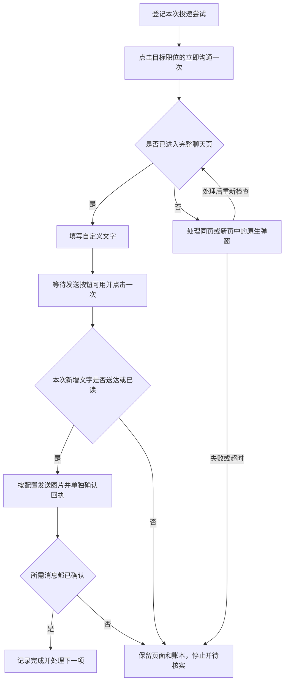

# BOSS 直聘自动化教学：风控识别、稳定会话与消息确认

核对日期：2026-09-14。基于本项目当前源码、已有故障回归记录，以及 Patchright / Playwright 官方文档。

这份讲义解释目前工程里实际处理了什么。平台内部的账号评分、设备评分、IP 规则和接口签名算法，没有在本项目中得到验证。不能把浏览器驱动的功能说明当作 BOSS 使用某项检测的证据。

## 1. 先区分三类问题

| 类别 | 例子 | 处理方向 |
| --- | --- | --- |
| 平台身份与访问限制 | 明确出现登录页、安全验证、操作频繁或次数上限提示 | 保留页面，暂停任务，登录或人工处理验证；达到限制就停止 |
| 网页交互与业务确认 | 弹窗挡住按钮、按钮仍在防抖、消息只有气泡没有送达状态 | 修复页面流程，等待实际可用状态，检查本次消息回执 |
| 本地程序与驱动错误 | Python 回调异常、浏览器对象已关闭、代码误操作旧标签页 | 根据异常发生阶段修复代码与页面生命周期 |

教学时先看错误发生在“导航前、点击前、点击后”哪一步，再判断原因。`Timeout 8000ms exceeded` 只是等待失败，不能独立证明触发了反爬。

## 2. 反爬相关机制与工程应对

| 讨论点 | 能确认的内容 | 本项目的处理办法 |
| --- | --- | --- |
| 登录会话 | 持久化浏览器可以保留本地会话状态；会话仍可能过期 | 每个平台一个专用 profile，首次人工登录；重新启动时复用并重新检查状态 |
| 自动化环境信号 | Patchright 调整了部分 CDP 使用方式与 Chromium 启动参数 | BOSS 使用 Patchright；保持配置稳定；升级后做真实驱动回归 |
| 验证和访问频率 | 当前代码识别验证、过频、上限等页面提示；这不代表每条提示都已在本账号出现 | 串行处理，配置本地上限和间隔；发现明确限制立即暂停，不循环刷新验证页 |
| 动态请求参数 | 本项目没有验证 BOSS 当前的签名生成链、有效期或完整参数绑定规则 | 通过网页正常交互，让网页执行它自己的请求流程；不把固定 Cookie 或过期签名样例当通用方案 |
| 页面变化 | 已处理完整聊天页、原生确认框、旧版小聊天弹窗等不同入口 | 按页面状态分支，定位目标会话，兼容同页跳转和新标签页 |
| 异步消息 | 点击、出现气泡、上传文件都不等于业务成功 | 记录发送前的消息基线，等待本次新增消息的送达或已读标记 |

Patchright 官方说明了避免使用 `Runtime.enable`、调整 `Console.enable` 相关行为和启动参数等补丁；它只支持 Chromium 系浏览器，并存在兼容性差异。这说明它处理了一些已知自动化信号，不能据此承诺 BOSS 永远检测不到，也不能证明此前错误就是某个 CDP 信号引起的。[Patchright 官方说明](https://github.com/Kaliiiiiiiiii-Vinyzu/patchright#patches)

项目默认的每日 50 次尝试、5–10 秒随机间隔只是应用配置，不是 BOSS 官方额度或经过验证的安全阈值。随机等待用于分散连续动作，不能作为不受限制的保证。

## 3. 核心代码：持久化浏览器

下面是独立的登录演示，环境需已有 Chrome 和项目依赖。只打开主页，供人工登录；按回车后关闭浏览器并保存本地状态。

```python
import asyncio
from pathlib import Path
from patchright.async_api import async_playwright


async def main():
    profile = Path("demo-data/profiles/boss").resolve()
    profile.mkdir(parents=True, exist_ok=True)

    async with async_playwright() as driver:
        context = await driver.chromium.launch_persistent_context(
            user_data_dir=str(profile),
            channel="chrome",
            headless=False,
            no_viewport=True,
            accept_downloads=False,
        )
        context.set_default_timeout(8000)
        context.set_default_navigation_timeout(35000)
        try:
            page = context.pages[0] if context.pages else await context.new_page()
            await page.goto("https://www.zhipin.com/", wait_until="domcontentloaded")
            await asyncio.to_thread(input, "请手动登录；完成后按回车保存并退出：")
        finally:
            await context.close()


if __name__ == "__main__":
    asyncio.run(main())
```

profile 应是程序专用目录，同一目录不要被多个浏览器实例同时使用。它可能包含可用于恢复登录的敏感状态，教学材料只分享源码，不分享 profile。[持久化上下文文档](https://playwright.dev/python/docs/api/class-browsertype#browser-type-launch-persistent-context)、[认证状态文档](https://playwright.dev/python/docs/auth)

项目实现见 [browser.py 的驱动和上下文管理](../jobs_app/browser.py)。

## 4. 核心代码：验证检测与暂停

下列函数是从项目提炼的教学片段。调用者收到异常后应停止任务并保留浏览器页面。没有匹配到验证文案，仅表示未检测到这些提示，不等于已登录或一定可以操作。

```python
import re
from urllib.parse import urlsplit

CHALLENGE = re.compile(
    r"请完成安全验证|访问验证|请(?:按住|拖动)滑块|完成验证后|操作过于频繁|访问过于频繁"
)
LIMIT = re.compile(r"今日投递太多|休息一下明天再来|已达.{0,8}上限|达到.{0,8}上限|次数过多")


async def guard(page):
    if page.is_closed():
        raise RuntimeError("任务页面已关闭")

    body = await page.locator("body").inner_text(timeout=5000)
    if "verify-slider" in page.url or CHALLENGE.search(body):
        raise RuntimeError("发现验证或访问频率提示，暂停并人工处理")
    if LIMIT.search(body):
        raise RuntimeError("平台提示次数限制，停止本轮任务")
    if urlsplit(page.url).path.startswith("/web/user"):
        raise RuntimeError("进入登录页面，请先完成登录")
```

生产实现还检查退出登录的元素、短时间导航循环，以及平台页面退回空白页。循环检测的“12 秒内至少 6 次导航或同一路径至少 4 次”是程序自定的诊断阈值，不能称为平台风控规则。只记录主机名和路径，避免在日志中带出查询参数内的会话信息。

## 5. 核心代码：聊天入口与发送确认

正确流程是：



进入聊天页必须来自目标职位的操作链。用户点击“立即沟通”已经直接跳转时，就使用该页；只在实际出现原生确认框时点“继续沟通”。处理旧小弹窗时，要先关闭遮挡层，再操作它下面的入口。

### 5.1 回调要兼容真实驱动

```python
popups = []
page.on("popup", lambda popup: popups.append(popup))
```

不要在本项目已验证的驱动版本中写成 `page.on("popup", popups.append)`。驱动会在回调上保存包装属性，内置列表方法无法接收该属性，因而产生 `_pw_impl_instance_` 异常。这是 Python 回调兼容错误，发生在真正导航和发送之前。

### 5.2 读取消息回执

这是项目方法的核心片段，放在 `BrowserAutomation` 类中使用。选择器是当前源码采用的写法，此前依据公开前端脚本核对；平台更新后需要重新核对，本轮未进行真实页面验收。

```python
async def _boss_receipts(self, page, kind: str, text: str = "") -> list[dict]:
    return await page.locator("li.message-item.item-myself[data-mid]").evaluate_all(r"""(rows, target) => {
        const norm = value => (value || '').replace(/[\u200b-\u200d\ufeff]/g, '').replace(/\s+/g, ' ').trim();
        return rows.filter(row => {
            if (target.kind === 'image') return row.querySelector('.message-image-content img.message-image');
            const content = row.querySelector('.text .text-content');
            return content && norm(content.innerText || content.textContent) === norm(target.text);
        }).map(row => ({id: row.getAttribute('data-mid'),
            state: row.querySelector('.message-status.status-error') ? 'failed' :
                row.querySelector('.message-status.status-delivery, .message-status.status-read') ? 'sent' : 'pending'
        }));
    }""", {"kind": kind, "text": text})
```

这里检查的是页面展示的送达/已读状态，不是只检查气泡，也不是独立验证服务器数据库。只取消息 ID 和状态，避免把聊天正文或图片地址输出到日志。

### 5.3 等待本次消息，而不是误认旧消息

下面是教学提炼的类方法，依赖项目的 `_boss_open_chat`、`_guard` 和上面的 `_boss_receipts`，不是单文件可独立运行的脚本。调用它会执行发送，应只在已选定接收方并获得发送授权的流程中调用。

```python
async def send_text_once(self, page, text, popups=None):
    try:
        page = await self._boss_open_chat(page, popups)
        if not text.strip():
            return "unconfirmed"
        previous = await self._boss_receipts(page, "text", text)
        before_ids = {row["id"] for row in previous}

        editor = page.locator("div#chat-input.chat-input[contenteditable='true']").first
        await editor.fill(text.strip(), timeout=5000)
        send = page.locator("button[type='send'].btn-send:not(.disabled)").first
        await send.wait_for(state="visible", timeout=5000)
        await send.click(timeout=5000, no_wait_after=True)

        for _ in range(40):
            await page.wait_for_timeout(300)
            await self._guard(page, "boss")
            rows = await self._boss_receipts(page, "text", text)
            if len(rows) > len(previous):
                last = rows[-1]
                if last["id"] and last["id"] not in before_ids:
                    if last["state"] == "sent":
                        return "submitted"
                    if last["state"] == "failed":
                        return "failed"
        return "unconfirmed"
    except Exception:
        # 点击可能已经生效；调用者应保留页面并记录待核实，不能自动重发。
        return "unconfirmed"
```

需要讲清四点：

1. 发送按钮通过 CSS 类 `.disabled` 表示暂不可用，因此显式等它移除。Playwright 的原生 enabled 检查并不把任意 CSS 类当作禁用属性。[动作可用性检查](https://playwright.dev/python/docs/actionability#enabled)
2. 同时要求“匹配消息条数增加”和“末条消息 ID 不在旧集合”。只判断新 ID 不够，因为旧消息收到服务器确认后可能从临时 ID 改成正式 ID。
3. 轮询观察状态可以重复，发送动作只执行一次。上面的约 12 秒是代码等待安排，DOM 调用耗时会使总时间更长，不是服务器超时时间或平台频控参数。
4. 列表换页、会话切换或历史消息补载可能破坏基线假设。应保持目标会话稳定；这个方案提高确认可靠性，但不能宣称端到端“恰好一次”。

图片使用同一原则：文字送达后再选择图片，处理明确的图片预览框，等待新增本人图片消息的送达/已读状态。文件选择成功不算送达；图片失败不能触发文字重发。完整实现在 [browser.py 的 `_boss_message` 与 `_boss_image`](../jobs_app/browser.py)。

Playwright 点击还会检查遮挡与稳定性。弹窗遮挡导致超时应修复弹窗流程；`force=True` 只跳过部分检查，不会证明业务操作成功。[自动等待说明](https://playwright.dev/python/docs/actionability)

#